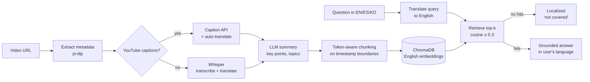

# Say What? · ¿Qué dijiste? · 뭐라고요?

**Ask questions about any video, in English, Spanish or Korean, and get answers grounded in what was actually said, with timestamped citations.**

[](https://github.com/dojedaro/say-what/actions/workflows/ci.yml)


[](LICENSE)

Say What? turns a YouTube, TikTok or Instagram video into searchable knowledge. It transcribes the video, translates it, summarizes it, and indexes it for retrieval-augmented chat that refuses to answer when the video doesn't cover the question.

## Features

- **Multilingual end-to-end:** transcripts, summaries and chat in English, Spanish and Korean. Ask in Spanish about a Korean video.
- **Grounded RAG chat:** answers use only retrieved transcript chunks, cite the moment in the video, and come with a retrieval-confidence score.
- **Refuses instead of guessing:** if nothing relevant is retrieved, the model is never called for an answer.
- **Bring your own model:** OpenAI, Anthropic Claude, Google Gemini or Azure OpenAI behind one interface. Visitor keys are used per request and never stored.
- **Export:** JSON (including RAG-ready chunks) or Markdown.

## How it works



### Design decisions

| Decision | Why |
|---|---|
| **Embed the English translation, keep the original text for display** | One embedding space for all three languages. Cross-lingual queries work without a multilingual embedding model, and users still see the original words. |
| **Chunk on caption/Whisper segment boundaries** | Chunks never split a sentence mid-timestamp, so every citation links to a playable moment (`&t=125s`). |
| **Similarity threshold before generation** | The cheapest hallucination guard is to not ask the model at all when retrieval finds nothing relevant. |
| **One `LLMClient` interface for four providers** | Features ask for "system + user → text". Provider quirks (Claude thinking blocks, Gemini config, Azure endpoints) are contained in one module. |
| **One `ContentPipeline` shared by the API and the seed script** | A single implementation of extract → transcribe → summarize → chunk → index. Re-runnable on failed items. |
| **Blocking work runs in worker threads** | Whisper, yt-dlp and LLM calls are synchronous. The background task and chat endpoint are plain `def`, so FastAPI runs them in a threadpool and the event loop stays responsive. |
| **Whisper is an optional dependency** | It pulls in PyTorch (~1 GB). Without it, the app still handles any video with YouTube captions. |

## Stack

| Layer | Built with |
|---|---|
| API and web | FastAPI, Uvicorn, Jinja2 templates, signed session cookies |
| Video and transcripts | yt-dlp, youtube-transcript-api, optional OpenAI Whisper |
| LLMs | OpenAI, Anthropic Claude, Google Gemini and Azure OpenAI behind one `LLMClient` |
| Retrieval | ChromaDB, tiktoken-based chunking |
| Data and settings | SQLAlchemy (SQLite), Pydantic Settings |
| Quality | pytest, GitHub Actions, Docker, Render blueprint |

## Results so far

- **61 tests pass in about 7 seconds** with a fake LLM and retriever, so no API keys are needed. They
  cover the API, chat service, chunker, extractor and the LLM provider adapters.
- **Retrieval quality isn't measured yet**, so this README makes no accuracy claim. The plan is in
  [Limitations and next steps](#limitations-and-next-steps).

## Quick start

```bash
git clone https://github.com/dojedaro/say-what.git
cd say-what
python -m venv .venv
source .venv/bin/activate          # Windows: .venv\Scripts\activate
pip install -r requirements.txt     # add -r requirements-whisper.txt for TikTok/Instagram (needs FFmpeg)

cp .env.example .env                # optional: a server key enables demo seeding and demo chat
uvicorn app.main:app --reload
```

Open http://localhost:8000. Interactive API docs are at `/docs`.

**Pre-load the demo videos** (needs one of `OPENAI_API_KEY`, `ANTHROPIC_API_KEY` or `GOOGLE_API_KEY` in `.env`):

```bash
python scripts/seed_demo.py
```

| Demo | Language |
|---|---|
| Dario Amodei interview | English |
| Checo Pérez interview | Spanish |
| Korean news report | Korean |

### Docker

```bash
docker build -t say-what .                                  # full image with Whisper
docker build --build-arg WITH_WHISPER=false -t say-what .   # ~1 GB smaller, captions only
docker run -p 8000:8000 --env-file .env say-what
```

`render.yaml` is included for one-click deployment on Render.

## API

| Method | Endpoint | Description |
|---|---|---|
| `GET` | `/api/providers` | Supported providers and models |
| `POST` | `/api/extract` | Queue a URL for processing (re-runs previously failed URLs) |
| `GET` | `/api/content/{id}/status` | Pipeline stage: `extracting → transcribing → summarizing → indexing → completed` |
| `GET` | `/api/content/{id}` | Transcript, summary, key points, topics |
| `GET` | `/api/content/{id}/chunks` | RAG chunks with timestamp deep links |
| `GET` | `/api/content/{id}/export?format=json\|markdown` | Export |
| `GET` | `/api/contents` | List processed content |
| `POST` | `/api/chat` | Grounded chat message |
| `GET`/`DELETE` | `/api/chat/history/{id}/{session}` | Read or clear chat history |

## Project structure

```
app/
├── main.py               # App factory: logging, middleware, routers
├── config.py             # Settings + provider/model catalog (single source of truth)
├── models.py / schemas.py
├── routers/              # api.py (REST), chat.py (RAG chat), web.py (Jinja2 UI)
└── services/
    ├── llm.py            # LLMClient: OpenAI, Anthropic, Gemini, Azure adapters
    ├── pipeline.py       # extract → transcribe → summarize → chunk → index
    ├── extractor.py      # yt-dlp metadata/audio, platform detection
    ├── transcriber.py    # YouTube captions with Whisper fallback
    ├── summarizer.py     # Structured JSON summary
    ├── chunker.py        # Token-aware chunking with overlap
    ├── vector_store.py   # ChromaDB, one collection per video
    └── chat.py           # Translate → retrieve → grounded answer
tests/                    # 61 tests: unit (chunking, LLM adapters, chat) + HTTP (TestClient)
```

## Development

```bash
pip install -r requirements-dev.txt
pytest           # runs offline: LLMs, downloads and embeddings are faked
ruff check . && ruff format --check .
```

CI runs lint and tests on every push and pull request.

## Limitations and next steps

- **Retrieval quality is not yet measured.** The next step is a small labeled question set per demo video, reporting recall@k and answer faithfulness, so threshold and chunk-size choices are backed by numbers.
- **Translation alignment is approximate.** Translated text is split across caption segments proportionally to length, which can drift on long segments.
- **Rate limiting is per browser session** (signed cookie) and is easy to bypass. A real deployment would limit per IP or per account.
- **SQLite and an in-process background task** fit a single-instance demo. Scaling out would mean Postgres plus a task queue (e.g. Celery or Arq).

## License

[MIT](LICENSE) © Daniel Ojeda
